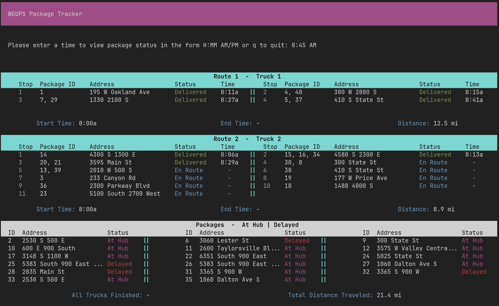

# Package Delivery Routing System

A Python application that simulates package delivery operations using route optimization and custom data structures. The system calculates delivery routes, tracks package statuses, and provides an interface for querying delivery information at different times throughout the day.

Originally developed for a university software engineering project, the application demonstrates algorithm design, data structure implementation, and object-oriented programming.


*Package tracking interface showing delivery statuses and route information.*

## Features

- **Route optimization:** Uses a nearest-neighbor algorithm to select delivery destinations and reduce total travel distance.
- **Custom hash table:** Implements a hash-based data structure for efficient package storage and retrieval.
- **Delivery simulation:** Simulates truck routes, package deliveries, and delivery timestamps.
- **Package tracking:** Allows users to view delivery statuses at a specified time.
- **Operational constraints:** Coordinates deliveries across three trucks and two drivers while accounting for truck capacity, delivery deadlines, and a total mileage limit.

## Technical Approach

The application uses a nearest-neighbor heuristic to construct delivery routes based on distances between delivery locations. This approach provides a computationally manageable solution to the routing problem, although it does not guarantee globally optimal routes.

A custom hash table stores package information and supports average-case constant-time lookup. Package delivery times and statuses are calculated based on simulated truck movements.

## Getting Started

**Requirements:** Python 3

Clone the repository:

```bash
git clone https://github.com/dillon-christensen/package-delivery-routing.git
cd package-delivery-routing
```

Run the application:

```bash
python main.py
```

## Project Background

This application was originally developed as part of the Software Development curriculum at Western Governors University.
